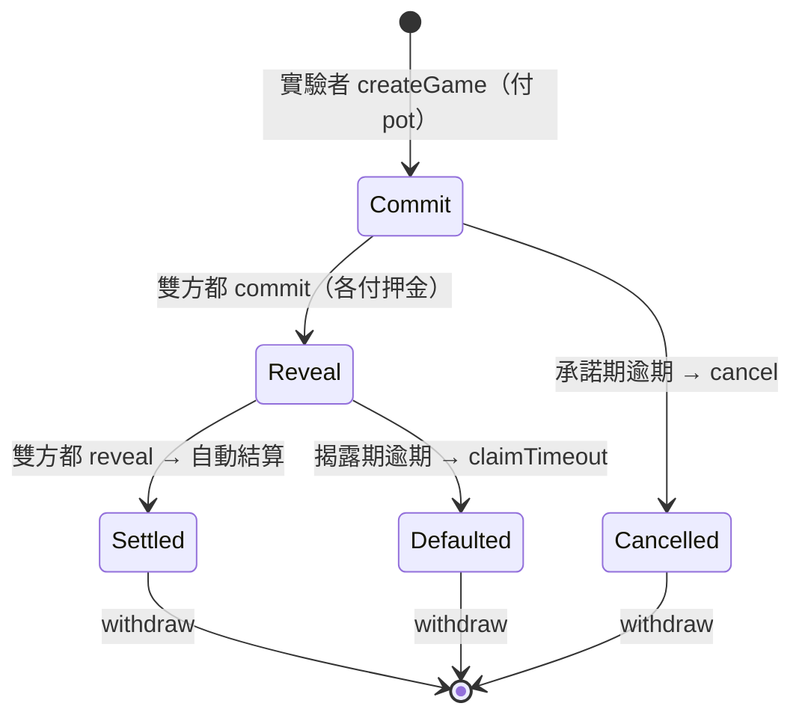

# 最後通牒賽局視角下的 MEV 分潤分析

**區塊鏈導論 第四組**　鄧杰修、曾士育、林玎揚、周家釩

<!--ABSTRACT-->

---

## 0. 研究問題與報告架構

最後通牒賽局裡，提議者決定怎麼分一筆錢，回應者只能接受或拒絕；拒絕則雙方都拿不到。理論預測提議者幾乎全拿，但真人實驗中提議多落在四到五成，太低的提議常被拒絕（Güth et al., 1982）。

以太坊的 MEV 分潤有兩個環節長得很像這個賽局：

| 環節 | 提議者 | 回應者 | 「拒絕」的意義 |
|---|---|---|---|
| Searcher → Builder | Searcher 決定分多少給 Builder | Builder | 不打包這個 bundle |
| Builder → Proposer（MEV-Boost） | Builder 用出價決定付多少給 Proposer | Proposer（驗證者） | 改用別家 Builder 的區塊，或自己建塊 |

但鏈上多了三件事：**有很多個提議者在競爭**、**回應者有退路（自己建塊）**、**出價公開且每 12 秒重複一次**。我們要回答的問題是：

> 加入這些特性後，均衡下 Proposer 應該分到多少？鏈上的實際資料符合嗎？在匿名、由程式自動執行的環境裡，「公平偏好」還看得到嗎？

本報告以 Builder → Proposer 這一層為主，分成四個部分，每一部分由一位組員負責：

| 部分 | 內容 | 產出 |
|---|---|---|
| **第一部分　模型主體** | 基本最後通牒 → 外部選項 → 多 Builder 競爭，推導均衡分潤 | 命題 1–4、可檢驗的預測 |
| **第二部分　公平偏好與模型統整** | Fehr–Schmidt 公平偏好下的門檻與最適出價；公平偏好遇到競爭會怎樣；四種情境總表 | 命題 5–8、情境比較表 |
| **第三部分　鏈上資料實證** | 用 MEV-Boost relay 公開資料與鏈上餘額檢驗預測 | 資料集、圖表、迴歸 |
| **第四部分　智能合約** | commit-reveal 最後通牒賽局合約、測試、用模擬玩家跑完整流程 | 合約、27 個測試、模擬結果 |

口頭報告的分工見第 6 節。

---

## 第一部分　模型主體：從最後通牒到競爭出價

### 1.1 設定

- 一個 slot 的區塊對 Builder $i$ 的價值是 $V_i$（他能從這個區塊收到的手續費與 MEV 總和）。
- Builder 出價 $s$ 給 Proposer。Proposer 接受：Builder 得 $V_i - s$，Proposer 得 $s$。
- Proposer 拒絕所有出價時自己建塊，得到 $L$（**外部選項**，只含公開交易池的手續費），Builder 得 0。
- **分潤比例**定義為 $\sigma = s / V$：Proposer 拿走區塊總價值的幾成。

### 1.2 基本模型（一個 Builder、沒有退路）

**命題 1.** 設 $L = 0$、只有一個 Builder、雙方只在乎自己的金錢報酬。子賽局完美均衡為 $s^* = 0$，Proposer 接受；$\sigma^* = 0$。

*證明.* 逆向歸納。最後一步，Proposer 接受得 $s$、拒絕得 0，所以任何 $s > 0$ 都接受，$s = 0$ 時無差異。若 Proposer 在 $s=0$ 時拒絕，Builder 想出「比 0 大一點點」但沒有最小的正數，最適反應不存在；所以均衡中 Proposer 必須在 $s=0$ 時接受，Builder 出 $s^*=0$。若金額有最小單位 $\varepsilon$，另有一個均衡是 $s^* = \varepsilon$。$\blacksquare$

這就是教科書版本：提議者幾乎全拿。

### 1.3 加入外部選項

**命題 2.** 只有一個 Builder、Proposer 有外部選項 $L$。若 $V \ge L$，均衡為 $s^* = L$，$\sigma^* = L/V$；若 $V < L$，沒有交易，Proposer 自己建塊。

*證明.* Proposer 接受的條件變成 $s \ge L$。Builder 的利潤 $V - s$ 隨 $s$ 遞減，所以出剛好讓對方接受的最小值 $s = L$；這要求 $V - L \ge 0$。$\blacksquare$

**含意.** 外部選項給 Proposer 一個保底，但 Builder 仍拿走全部的「額外價值」$V - L$——也就是 Builder 靠私有訂單流與 MEV 多做出來的部分。獨占的 Builder 面對的仍是最後通牒，只是底線從 0 變成 $L$。

### 1.4 加入多個 Builder 競爭

現在有 $n$ 個 Builder，價值 $V_1 > V_2 \ge \dots \ge V_n$，同時出價 $b_1,\dots,b_n$。Proposer 選最高出價，但若最高出價低於 $L$ 就自己建塊。同價時由價值較高的 Builder 得標（這是確保均衡存在的標準假設）。

**命題 3.** 令 $p^* = \max(V_2, L)$ 並假設 $V_1 > p^*$。在所有「沒有人出價超過自己價值」的純策略納許均衡中，得標者都是 Builder 1，得標價都是
$$
s^* = \max(V_2,\ L), \qquad \sigma^* = \frac{\max(V_2, L)}{V_1}.
$$

*證明.* 設均衡的最高出價為 $p$。

1. **一定成交，且 $p \ge L$。** 若 $p < L$，沒有人得標，Builder 1 改出 $L$ 可賺 $V_1 - L > 0$。
2. **$p \ge V_2$。** 若 $p < V_2$：得標者若不是 Builder 2，Builder 2 改出 $p' \in (p, V_2)$ 可從 0 變成賺 $V_2 - p' > 0$；得標者若是 Builder 2，Builder 1 改出 $p' \in (p, V_1)$ 可賺 $V_1 - p' > 0$。兩種情況都有人想偏離。
3. **得標者是 Builder 1。** 若得標者 $j \ne 1$，因為他不會出超過自己的價值，$p \le V_j \le V_2$，配合第 2 點得 $p = V_2$。此時 Builder 1 也出 $p$ 就能（靠同價規則）得標並賺 $V_1 - V_2 > 0$，矛盾。
4. **$p \le p^*$。** 其他人的出價都不超過自己的價值，所以都 $\le V_2$。若 Builder 1 出的 $p > \max(V_2, L)$，他把出價降到 $p^*$ 仍然得標，而且賺更多，矛盾。

合起來 $p = p^*$。均衡確實存在：$b_1 = p^*$、其餘 $b_j = V_j$。Builder 1 再降價就會輸給 Builder 2 或低於 $L$；其他人要贏就得出到 $p^* \ge V_j$ 以上，沒有利潤。$\blacksquare$

**數值核對.** 我們把出價限制在 0.05 的格點上，暴力列舉所有均衡。$(V_1,V_2,V_3,L) = (1, 0.7, 0.4, 0.2)$ 的均衡得標價是 $\{0.65, 0.70\}$；$(1, 0.3, 0.1, 0.5)$ 是 $\{0.50\}$；只有一個 Builder 且 $L = 0.25$ 時是 $\{0.25\}$。都落在 $\max(V_2, L)$ 的一個格點以內（`results/model_check.json` 的 `first_price_bruteforce`）。

**為什麼這個結果在 MEV-Boost 特別合理.** 命題 3 假設彼此知道對方的價值，看起來很強；但 MEV-Boost 的出價是**公開、可以一直加價**的（每個 slot 內 Builder 會送出幾百到上千筆出價），實際上更像公開喊價的英式拍賣。英式拍賣中，每個人最多喊到自己的價值，第二強的人在 $V_2$ 退出，得標價同樣是 $V_2$，而且不需要知道彼此的價值。所以 $s^* \approx \max(V_2, L)$ 不依賴完全資訊的假設。

### 1.5 從競爭退回最後通牒

把命題 1–3 排在一起：

| 情境 | 均衡出價 $s^*$ | Proposer 分潤 $\sigma^*$ |
|---|---|---|
| 一個 Builder、沒有退路 | $0$ | $0$ |
| 一個 Builder、有退路 $L$ | $L$ | $L / V_1$ |
| 多個 Builder、有退路 $L$ | $\max(V_2, L)$ | $\max(V_2, L)/V_1$ |
| 兩個以上 Builder 價值相同 | $V_1$ | $1$ |

**分潤由「第二強的對手有多強」決定，不是由 Builder 有幾家決定。** 只要 $V_2$ 貼近 $V_1$，Proposer 就幾乎全拿；$V_2$ 掉下去，Builder 1 的利潤 $V_1 - \max(V_2, L)$ 就變大；當 $V_2 \le L$，競爭完全失效，回到命題 2 的最後通牒。

Builder 家數仍然有間接影響，因為家數越多，第二名越可能貼近第一名：

**命題 4.** 若 $V_1,\dots,V_n$ 獨立且都服從 $[0, \bar V]$ 上的均勻分布，$L = 0$，則 $E[\sigma^*] = E[V_{(2)}/V_{(1)}] = \dfrac{n-1}{n}$。

*證明.* 給定最大值為 $m$，其餘 $n-1$ 個值獨立均勻分布在 $[0, m]$，它們的最大值除以 $m$ 服從 $\mathrm{Beta}(n-1, 1)$，期望值為 $(n-1)/n$，與 $m$ 無關。$\blacksquare$

模擬（每個 $n$ 做 20 萬次）與公式吻合：$n = 2, 5, 20$ 時分別為 0.500、0.800、0.950。但若價值是厚尾分布（對數常態，$\sigma=1$），$n = 20$ 時期望分潤只有 0.676：**偶爾出現的大額 MEV 會讓某一家 Builder 遠遠領先，即使對手很多，那個 slot 仍接近最後通牒**（`results/model_check.json` 的 `share_vs_n`）。

### 1.6 Searcher → Builder 這一層

結構相同，只是角色往上移一層：Searcher 是提議者，Builder 是回應者，「外部選項」是 Builder 不收這個 bundle 時該位置原本能賺的手續費，「競爭」是多個 Searcher 搶同一個套利機會。同一個機會被多個 Searcher 發現時，命題 3 預測 Searcher 幾乎把全部利潤出給 Builder；獨家機會則接近最後通牒。把兩層串起來（Builder 的 $V_i$ 本身取決於 Searcher 付多少）超出本專題範圍，列為未來工作。

### 1.7 可以拿資料檢驗的預測

- **預測一（競爭定價）**：得標價應該貼近「最強對手的最高出價」，兩者比值接近 1。
- **預測二（分潤高低取決於對手強度）**：Proposer 分潤比例隨「對手最高出價 ÷ 區塊價值」上升；整體而言分潤應遠高於最後通牒實驗的四到五成。
- **預測三（外部選項很少是決定因素）**：只有在 $L > V_2$ 的 slot，$L$ 才決定價格。
- **預測四（公平偏好，見第二部分）**：若公平偏好有作用，低分潤的出價應該被拒絕；若沒有作用，只要高於 $L$ 就會被接受。

---

## 第二部分　公平偏好與模型統整

### 2.1 Fehr–Schmidt 公平偏好

Fehr & Schmidt (1999) 假設人除了自己的報酬，還討厭「不平等」。兩人情況下，自己拿 $x$、對方拿 $y$ 時效用為
$$
U(x, y) = x - \alpha \max(y - x,\ 0) - \beta \max(x - y,\ 0),
$$
其中 $\alpha \ge 0$ 是「吃虧時的不舒服」（嫉妒），$\beta \in [0, 1)$ 是「佔便宜時的不舒服」（愧疚），且 $\beta \le \alpha$。

**命題 5（回應者的接受門檻）.** 沒有外部選項時，回應者接受 $s$ 若且唯若
$$
s \ \ge\ \underline{s}(\alpha) = \frac{\alpha}{1 + 2\alpha}\, V .
$$

*證明.* 接受時回應者得 $s$、提議者得 $V - s$；拒絕時雙方都是 0，效用 0。
若 $s < V/2$（回應者吃虧）：$U_R = s - \alpha(V - 2s) \ge 0 \iff s \ge \alpha V/(1+2\alpha)$。
若 $s \ge V/2$（回應者佔便宜）：$U_R = s - \beta(2s - V)$ 是 $s$ 的線性函數，在 $s = V/2$ 時為 $V/2 > 0$，在 $s = V$ 時為 $(1-\beta)V > 0$，所以一定接受。$\blacksquare$

門檻隨 $\alpha$ 遞增，但永遠低於 $V/2$：$\alpha = 0.5, 1, 4$ 時分別是 $0.25V$、$0.333V$、$0.444V$。這解釋了實驗中「低於兩成常被拒絕」。

**命題 6（提議者的最適出價）.** 提議者的愧疚參數為 $\beta_P$、知道回應者的 $\alpha$ 時：若 $\beta_P > 1/2$，出 $s^* = V/2$；若 $\beta_P < 1/2$，出 $s^* = \underline{s}(\alpha)$。

*證明.* 在 $s \le V/2$ 的範圍，$U_P = (V - s) - \beta_P (V - 2s)$，對 $s$ 微分得 $2\beta_P - 1$。$\beta_P > 1/2$ 時效用隨 $s$ 遞增，一路加到 $V/2$（再往上換成自己吃虧，效用下降）；$\beta_P < 1/2$ 時越少越好，出到回應者剛好接受的門檻。$\blacksquare$

**不知道對方 $\alpha$ 時.** 用 Fehr & Schmidt (1999) 表 III 的偏好分布（$\alpha \in \{0, 0.5, 1, 4\}$ 的比例為 30%、30%、30%、10%；$\beta \in \{0, 0.25, 0.6\}$ 的比例為 30%、30%、40%），提議者在各門檻值中挑期望效用最大的出價：

| 提議者的 $\beta$ | 最適出價 | 被接受的機率 |
|---|---|---|
| 0（完全自利） | $V/3$ | 90% |
| 0.25 | $4V/9$ | 100% |
| 0.6 | $V/2$ | 100% |

母體平均出價是 $0.433V$、接受率 97%（`results/model_check.json` 的 `fs_proposer_optimal_offer`、`fs_population_prediction`）。**即使是完全自利的提議者，只要怕被拒絕，也會出到三成以上**——這與實驗觀察到的四到五成一致，也是第四部分合約模擬的理論對照值。

### 2.2 公平偏好加上外部選項

**命題 7.** 回應者拒絕後可得 $L$（提議者得 0）。接受門檻為
$$
\underline{s}(\alpha, \beta, L) = \frac{\alpha V + (1 - \beta) L}{1 + 2\alpha}\qquad(\text{當此值} \le V/2).
$$

*證明.* 拒絕時報酬為（回應者 $L$，提議者 0），回應者佔便宜，效用為 $L - \beta L$。接受且 $s < V/2$ 時效用為 $s - \alpha(V - 2s)$。令後者 $\ge$ 前者即得。$\blacksquare$

兩個極端都對得上：$\alpha = \beta = 0$ 時門檻是 $L$（命題 2）；$L = 0$ 時是 $\alpha V/(1+2\alpha)$（命題 5）。數值解與公式在五組參數下相符（`results/model_check.json` 的 `fs_threshold_with_outside_option`）。

### 2.3 公平偏好遇到競爭：誰說了算？

假設 Proposer 有公平偏好，並在「最高出價」與「自己建塊」之間選擇。Builder 1 要得標，出價必須同時 (a) 贏過 Builder 2、(b) 高過 Proposer 的公平門檻。

**命題 8.** 多個 Builder 競爭、Proposer 有公平偏好時，均衡得標價為
$$
s^* = \max\!\big(V_2,\ \underline{s}(\alpha,\beta,L)\big).
$$
特別地，只要 $V_2 \ge V_1/2$，公平偏好對結果**完全沒有影響**，分潤與命題 3 相同。

*證明.* 與命題 3 相同，只是把 Proposer 的接受底線從 $L$ 換成 $\underline{s}$。由命題 7，$\underline{s} \le V_1/2$，所以 $V_2 \ge V_1/2$ 時 $\max(V_2, \underline{s}) = V_2$。$\blacksquare$

這與 Fehr & Schmidt (1999) 對「提議者競爭的市場賽局」的結論一致，也與 Roth et al. (1991) 的實驗一致：只要提議者之間有競爭，回應者就幾乎拿走全部，不論參與者多在乎公平。

**公平門檻真的發揮作用的機率**（Builder 價值為獨立均勻分布，$L=0$，模擬 20 萬次；`results/model_check.json` 的 `prob_fairness_threshold_binds_uniform`）：

| Builder 家數 | $\alpha=0.5$ | $\alpha=1$ | $\alpha=4$ |
|---|---|---|---|
| 1 | 100% | 100% | 100% |
| 2 | 25.0% | 33.3% | 44.5% |
| 3 | 6.4% | 11.2% | 19.8% |
| 5 | 0.4% | 1.2% | 4.0% |
| 10 | 0.0% | 0.0% | 0.1% |

五家以上 Builder 競爭時，就算 Proposer 極度在乎公平（$\alpha = 4$），公平門檻也只在 4% 的情況下有作用。

### 2.4 四種情境總表

| | 沒有公平偏好 | 有公平偏好（$\alpha > 0$） |
|---|---|---|
| **一個 Builder，$L=0$** | $s^* = 0$（命題 1） | $s^* = \dfrac{\alpha}{1+2\alpha}V$（命題 5、6） |
| **一個 Builder，有 $L$** | $s^* = L$（命題 2） | $s^* = \dfrac{\alpha V + (1-\beta)L}{1+2\alpha}$（命題 7） |
| **多個 Builder，有 $L$** | $s^* = \max(V_2, L)$（命題 3） | $s^* = \max(V_2, \underline{s})$（命題 8） |

三股力量把 Proposer 的分潤往上推：**競爭**（$V_2$）、**退路**（$L$）、**公平偏好**（$\alpha$）。均衡價格是三者中最強的那個。在 Builder 之間競爭激烈的市場，$V_2$ 遠大於另外兩個，所以：

- 鏈上的分潤應該**遠高於**實驗室的四到五成——不是因為 Builder 比較公平，而是因為他們在互相競價；
- 公平偏好在鏈上**觀察不到**也不需要存在：MEV-Boost 軟體本來就機械式地選最高出價。唯一接近「門檻」的東西是驗證者可以設定的最低出價（min-bid），但那是用外部選項 $L$ 在比，不是用公平在比；
- 一旦某個 slot 只有一家 Builder 有能力拿到那筆價值（$V_2 \ll V_1$），結果就退回最後通牒，而這時鏈上沒有公平偏好可以保護 Proposer。

<!--PART3-->

---

## 第四部分　智能合約：commit-reveal 最後通牒賽局

鏈上資料只能看到「競爭下的結果」。要看沒有競爭時人會怎麼做，需要一個可控的實驗環境。這一部分實作一個能在鏈上進行最後通牒賽局實驗的合約。程式在 `contracts/`。

### 4.1 設計目標

1. **不能後出**：任何一方都不能在看到對方的選擇後才決定自己的。
2. **一次收集完整策略**：回應者不是對某個出價說好或不好，而是事先承諾「最低可接受金額」（strategy method，Selten 1967）。這樣每一局都能得到回應者的門檻，而不只是一個接受/拒絕。
3. **不揭露要有代價**：否則輸的一方可以賴著不揭露。
4. **錢不會卡住、不會被多領**。

### 4.2 流程

| 階段 | 誰做什麼 | 金流 |
|---|---|---|
| 開局 | 實驗者指定提議者、回應者，付出獎金池 `pot` | `pot` 進合約 |
| 承諾 | 提議者送 $H(\text{offer})$，回應者送 $H(\text{threshold})$ | 各付押金 `deposit` |
| 揭露 | 各自公開數值與 salt，合約驗證 | — |
| 結算 | `offer ≥ threshold`：提議者得 `pot − offer`，回應者得 `offer`；否則雙方得 0，`pot` 退回實驗者 | 押金退回 |
| 逾期 | 沒揭露的人押金被沒收，給有揭露的一方；`pot` 退回實驗者 | — |

承諾值為 `keccak256(abi.encode(合約位址, chainid, 局號, 玩家位址, 數值, salt))`。

### 4.3 為什麼這樣設計是安全的

- **照抄承諾沒用**：承諾綁定玩家位址。回應者就算把提議者的承諾原封不動抄來，揭露時用自己的位址算出來的雜湊也對不上。
- **不能跨局、跨鏈重放**：承諾綁定局號、合約位址與 chainid。
- **數值猜不出來**：出價只有有限個可能值，沒有 salt 的話可以暴力枚舉；所以要求 32 bytes 的亂數 salt。
- **先揭露的人不會吃虧**：兩個承諾都上鏈後才開放揭露，後揭露的人雖然看得到對方的數值，但自己的數值早已被承諾鎖死，無法更改。
- **賴著不揭露一定比較差**：後揭露的人若發現結果對自己不利（例如提議者發現自己的出價低於對方門檻），揭露可以拿回押金，不揭露則押金被沒收且同樣拿不到 `pot`。只要押金大於 0，揭露嚴格優於不揭露。所以這個合約在策略上等價於「雙方同時行動」的最後通牒賽局。
- **提領採 pull payment**：結算只記帳，由當事人自己呼叫 `withdraw`，先歸零再轉帳，重入攻擊拿不到多的錢。
- **為什麼由實驗者出 `pot` 並指定配對**：若讓任何人自由配對，同一個人可以用兩個位址自己跟自己玩，直接把 `pot` 領走。

### 4.4 測試

單元測試 27 項全部通過（`results/contract_test_output.txt:39`），涵蓋：

| 類別 | 項數 | 內容 |
|---|---|---|
| 開局 | 2 | 參數紀錄；拒絕不合理參數（沒有 pot、自己對自己、押金為 0…） |
| 承諾 | 7 | 非玩家、押金錯誤、重複承諾、空承諾、逾期、單方承諾不能揭露、照抄承諾無效 |
| 揭露與結算 | 8 | 接受／剛好相等／拒絕的分配；數值或 salt 不符；超過 pot；重複揭露；逾期；邊界值 0 與 pot |
| 逾期處理 | 6 | 取消；一方不揭露（兩個方向）；雙方都不揭露；期限內不能主張逾期 |
| 提領 | 3 | 金額正確；全部提領後合約餘額為 0；重入攻擊失敗 |
| 多局並行 | 1 | 各局獨立；承諾不能跨局重放 |

Gas 用量（`results/contract_test_output.txt:60-76`）：

| 函式 | 平均 gas |
|---|---|
| `createGame` | 179,365 |
| `commit` | 57,693 |
| `reveal` | 97,301（第二個揭露含結算，最高 141,419） |
| `withdraw` | 29,898 |
| 部署 | 867,048 |

一局完整流程（開局＋2 次承諾＋2 次揭露＋3 人提領）約 58 萬 gas。

### 4.5 用模擬玩家跑完整流程

還沒有招募真人受試者，所以先用**模擬玩家**在本機測試鏈上把每一步都真的走一遍，確認合約能當實驗平台用，同時作為第二部分理論的對照。**以下是模擬，不是真人實驗結果。**

三組各 200 局，`pot` = 0.01 ETH、押金 0.001 ETH、出價最小單位為 `pot` 的 0.1%；每位玩家有 5% 機率不揭露，用來走逾期流程。結果由鏈上事件讀回（`data/contract_sim/summary.json`）：

| 組別 | 提議者 | 回應者 | 完成結算 | 逾期 | 平均出價 | 接受率 | 提議者平均所得 | 回應者平均所得 |
|---|---|---|---|---|---|---|---|---|
| 自利 對 自利 | 出最小單位 | 全部接受 | 183 | 17 | 0.1% | 100% | 99.9% | 0.1% |
| 自利 對 公平 | 出最小單位 | Fehr–Schmidt 門檻 | 179 | 21 | 0.1% | 30.7% | 30.7% | 0.03% |
| 公平 對 公平 | 命題 6 的最適出價 | Fehr–Schmidt 門檻 | 179 | 21 | 43.8% | 96.6% | 54.0% | 42.6% |

- 「公平 對 公平」的平均出價 43.8%、接受率 96.6%，與第二部分的理論值 43.3%、97% 相符（差異來自抽樣）。
- 「自利 對 公平」顯示：照教科書均衡出價的提議者，遇到在乎公平的回應者，七成會被拒絕，平均只拿到 30.7%，遠不如出到三成以上。
- 腳本記錄的數值與鏈上事件 0 筆不一致；600 局總共付入 7.2 ETH、提領 7.2 ETH，合約最後餘額為 0。

### 4.6 還沒做的

- **尚未部署到 Sepolia 測試網**：部署需要錢包私鑰，腳本已備妥（`contracts/scripts/deploy.js`），步驟見 `contracts/README.md`。
- **尚未做真人實驗**：需要招募受試者與前端介面。另外測試網代幣沒有價值，真人實驗的誘因設計（例如事後依結果發放實際報酬）需要另外處理。

<!--CONCLUSION-->
