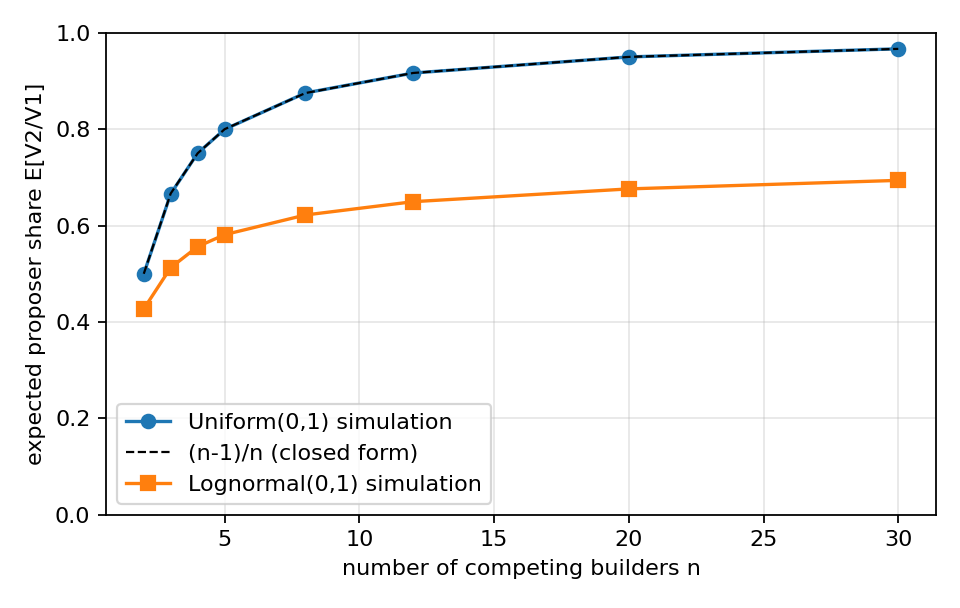
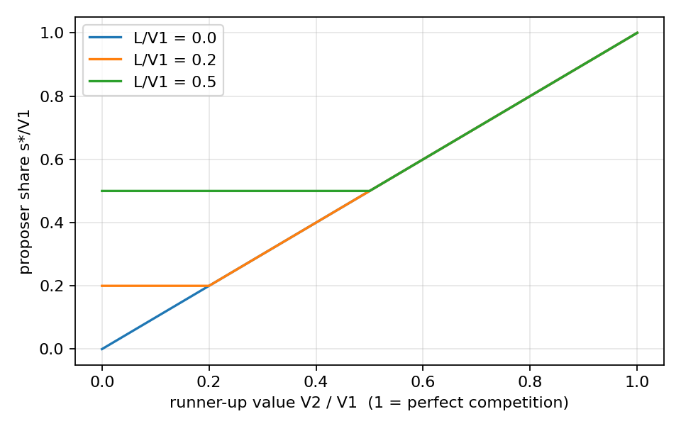
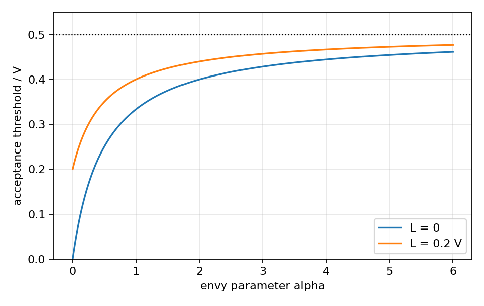
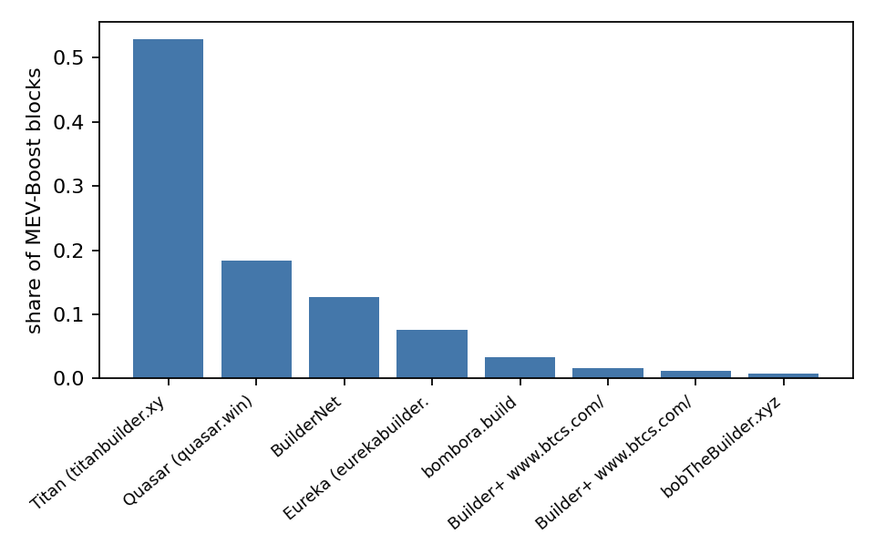
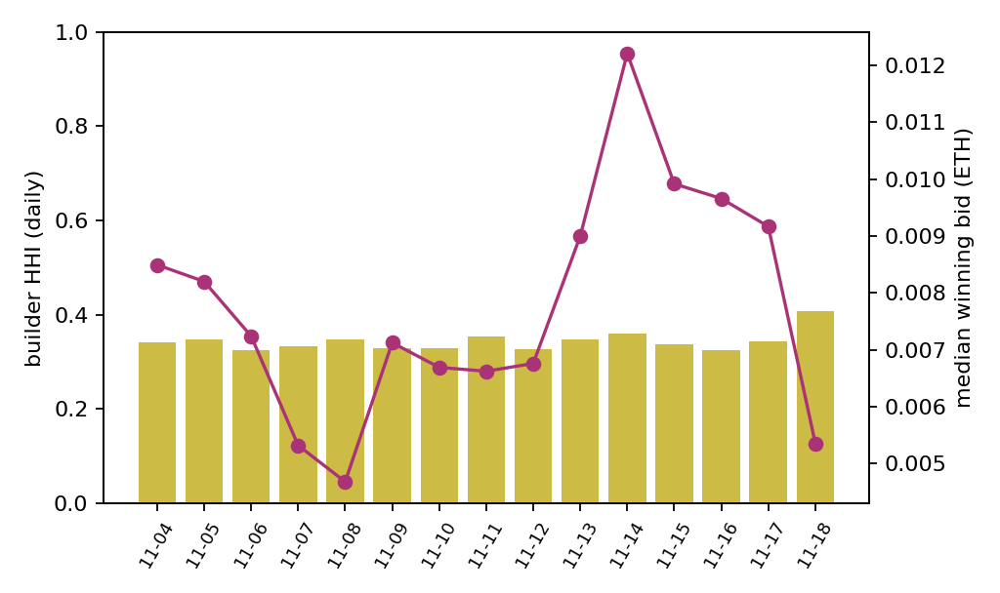
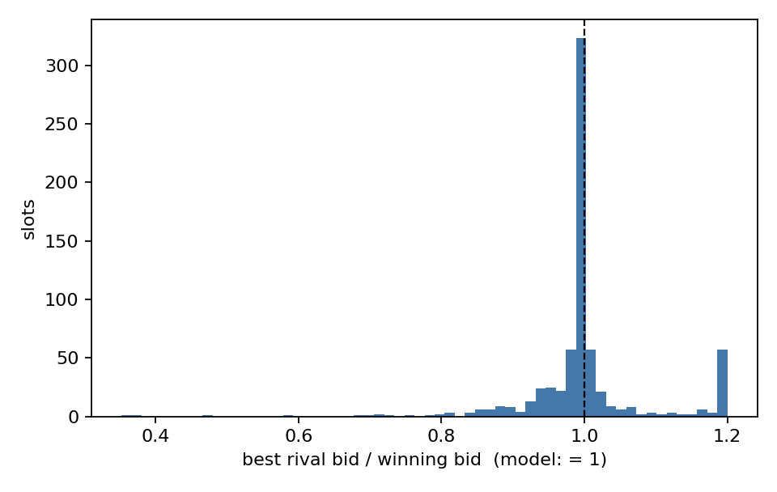
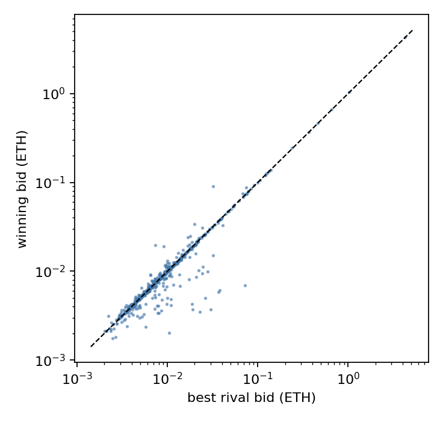
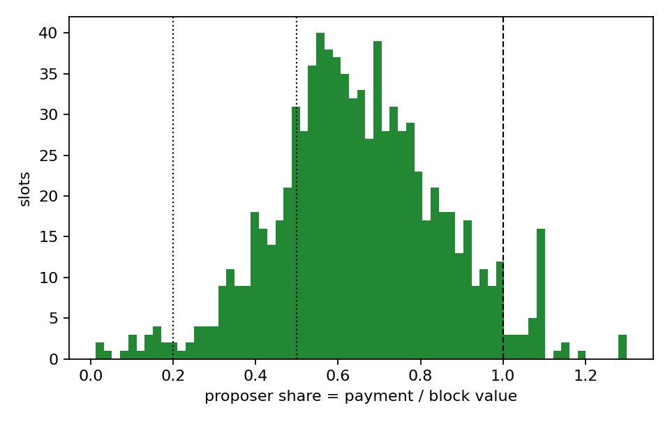
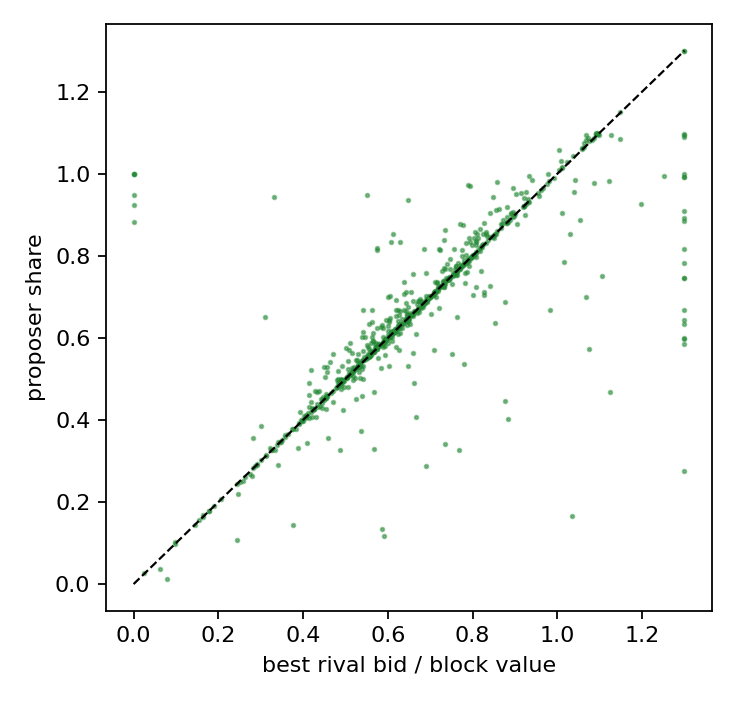
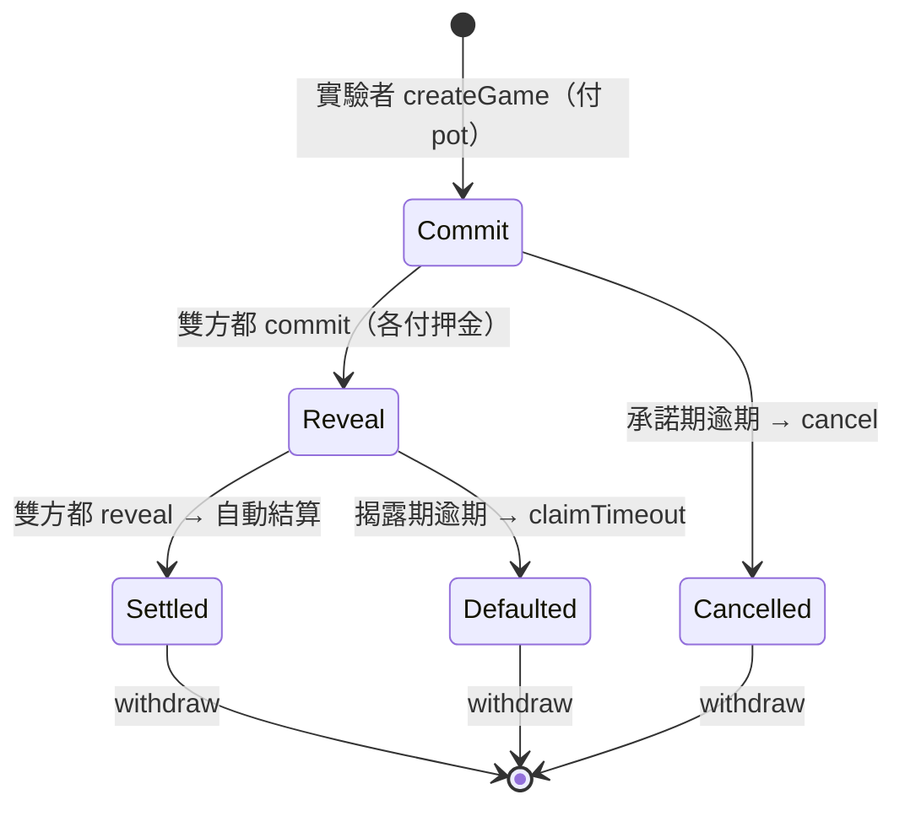

# 最後通牒賽局視角下的 MEV 分潤分析

**區塊鏈導論 第四組**　鄧杰修、曾士育、林玎揚、周家釩

> **摘要**　我們把以太坊 MEV-Boost 中 Builder 付錢給 Proposer 的過程，看成一個「有很多提議者、回應者有外部選項」的最後通牒賽局。理論上，均衡的得標價是 $\max(V_2, L)$：第二名的 Builder 的區塊價值與 Proposer 自己建塊價值中較大的那個；公平偏好只有在第二名很弱時才有作用。我們用 2026 年 11 月 4 日至 18 日共 14 天、92,587 個區塊的 relay 公開資料檢驗：得標價與對手最高出價的比值中位數為 0.9997，73% 的區塊差距在 5% 以內，符合「競爭定價」；但 Proposer 只拿到區塊價值的 64%（中位數），市占 53% 的最大 Builder 留下的比例最高，顯示第一名與第二名之間有一段靠獨家訂單流撐出來的差距。外部選項只在約 4% 的區塊可能是決定因素，鏈上也看不到公平偏好的痕跡。另外我們實作了 commit-reveal 的最後通牒賽局合約（27 項測試通過），並用模擬玩家驗證流程，作為未來真人實驗的平台。

---

## 0. 研究問題與報告架構

最後通牒賽局裡，提議者決定怎麼分一筆錢，回應者只能接受或拒絕；拒絕則雙方都拿不到。理論預測提議者幾乎全拿，但真人實驗中提議多落在四到五成，太低的提議常被拒絕（Güth et al., 1982）。

以太坊的 MEV 分潤有兩個環節長得很像這個賽局：

| 環節 | 提議者 | 回應者 | 「拒絕」的意義 |
|---|---|---|---|
| Searcher → Builder | Searcher 決定分多少給 Builder | Builder | 不打包這個 bundle |
| Builder → Proposer（MEV-Boost） | Builder 用出價決定付多少給 Proposer | Proposer（驗證者） | 改用別家 Builder 的區塊，或自己建塊 |

但鏈上多了三件事：**有很多個提議者在競爭**、**回應者有外部選項（自己建塊）**、**出價公開且每 12 秒重複一次**。我們要回答的問題是：

> 加入這些特性後，均衡下 Proposer 應該分到多少？鏈上的實際資料符合嗎？在匿名、由程式自動執行的環境裡，「公平偏好」還看得到嗎？

本報告以 Builder → Proposer 這一層為主，分成四個部分，每一部分由一位組員負責：

| 部分 | 內容 | 產出 |
|---|---|---|
| **第一部分　模型主體** | 基本最後通牒 → 外部選項 → 多 Builder 競爭，推導均衡分潤 | 命題 1–4、可檢驗的預測 |
| **第二部分　公平偏好與模型統整** | Fehr–Schmidt 公平偏好下的門檻與最適出價；公平偏好遇到競爭會怎樣；四種情境總表 | 命題 5–8、情境比較表 |
| **第三部分　鏈上資料實證** | 用 MEV-Boost relay 公開資料與鏈上餘額檢驗預測 | 資料集、圖表、迴歸 |
| **第四部分　智能合約** | commit-reveal 最後通牒賽局合約、測試、用模擬玩家跑完整流程 | 合約、27 個測試、模擬結果 |

### 用詞統一

本報告與簡報使用同一套名稱：

| 名稱 | 意思 |
|---|---|
| Searcher／Builder／Proposer | 鏈上的三個角色，一律用英文。「提議者／回應者」只用來講一般的最後通牒賽局 |
| 第一名、第二名 | 對同一個區塊，區塊價值最高與次高的 Builder；價值記為 $V_1$、$V_2$ |
| 區塊價值 $V$ | Builder 從這個區塊能收到的手續費與 MEV 總和 |
| 得標價 $s$ | 得標的 Builder 付給 Proposer 的金額 |
| Proposer 分潤比例 $\sigma$ | 得標價 ÷ 區塊價值 |
| 對手最高出價 | 得標當下，其他 Builder 仍有效的最高出價；資料上用它估計 $V_2$ |
| 外部選項 $L$ | Proposer 不採用任何 Builder、自己建塊能得到的價值 |
| 公平門檻 | 有公平偏好的回應者願意接受的最低金額（由 Fehr–Schmidt 模型算出） |
| 接受門檻 | 合約實驗中，回應者事先承諾的最低可接受金額 |
| 區塊、slot | slot 是 12 秒一格的出塊時段；資料分析的單位一律稱「區塊」 |

口頭報告的分工見第 6 節。

---

## 第一部分　模型主體：從最後通牒到競爭出價

### 1.1 設定

- 一個 slot 的區塊對 Builder $i$ 的價值是 $V_i$（他能從這個區塊收到的手續費與 MEV 總和）。
- Builder 出價 $s$ 給 Proposer。Proposer 接受：Builder 得 $V_i - s$，Proposer 得 $s$。
- Proposer 拒絕所有出價時自己建塊，得到 $L$（**外部選項**，只含公開交易池的手續費），Builder 得 0。
- **分潤比例**定義為 $\sigma = s / V$：Proposer 拿走區塊價值的幾成。

### 1.2 基本模型（一個 Builder、沒有外部選項）

**命題 1.** 設 $L = 0$、只有一個 Builder、雙方只在乎自己的金錢報酬。子賽局完美均衡為 $s^* = 0$，Proposer 接受；$\sigma^* = 0$。

*證明.* 逆向歸納。最後一步，Proposer 接受得 $s$、拒絕得 0，所以任何 $s > 0$ 都接受，$s = 0$ 時無差異。若 Proposer 在 $s=0$ 時拒絕，Builder 想出「比 0 大一點點」但沒有最小的正數，最適反應不存在；所以均衡中 Proposer 必須在 $s=0$ 時接受，Builder 出 $s^*=0$。若金額有最小單位 $\varepsilon$，另有一個均衡是 $s^* = \varepsilon$。$\blacksquare$

這就是教科書版本：提議者幾乎全拿。

### 1.3 加入外部選項

**命題 2.** 只有一個 Builder、Proposer 有外部選項 $L$。若 $V \ge L$，均衡為 $s^* = L$，$\sigma^* = L/V$；若 $V < L$，沒有交易，Proposer 自己建塊。

*證明.* Proposer 接受的條件變成 $s \ge L$。Builder 的利潤 $V - s$ 隨 $s$ 遞減，所以出剛好讓對方接受的最小值 $s = L$；這要求 $V - L \ge 0$。$\blacksquare$

**含意.** 外部選項給 Proposer 一個保底，但 Builder 仍拿走全部的「額外價值」$V - L$——也就是 Builder 靠私有訂單流與 MEV 多做出來的部分。獨占的 Builder 面對的仍是最後通牒，只是底線從 0 變成 $L$。

### 1.4 加入多個 Builder 競爭

現在有 $n$ 個 Builder，價值 $V_1 > V_2 \ge \dots \ge V_n$，同時出價 $b_1,\dots,b_n$。Proposer 選最高出價，但若最高出價低於 $L$ 就自己建塊。同價時由價值較高的 Builder 得標（這是確保均衡存在的標準假設）。

**命題 3.** 令 $p^* = \max(V_2, L)$ 並假設 $V_1 > p^*$。在所有「沒有人出價超過自己價值」的純策略納許均衡中，得標者都是 Builder 1，得標價都是
$$
s^* = \max(V_2,\ L), \qquad \sigma^* = \frac{\max(V_2, L)}{V_1}.
$$

*證明.* 設均衡的最高出價為 $p$。

1. **一定成交，且 $p \ge L$。** 若 $p < L$，沒有人得標，Builder 1 改出 $L$ 可賺 $V_1 - L > 0$。
2. **$p \ge V_2$。** 若 $p < V_2$：得標者若不是 Builder 2，Builder 2 改出 $p' \in (p, V_2)$ 可從 0 變成賺 $V_2 - p' > 0$；得標者若是 Builder 2，Builder 1 改出 $p' \in (p, V_1)$ 可賺 $V_1 - p' > 0$。兩種情況都有人想偏離。
3. **得標者是 Builder 1。** 若得標者 $j \ne 1$，因為他不會出超過自己的價值，$p \le V_j \le V_2$，配合第 2 點得 $p = V_2$。此時 Builder 1 也出 $p$ 就能（靠同價規則）得標並賺 $V_1 - V_2 > 0$，矛盾。
4. **$p \le p^*$。** 其他人的出價都不超過自己的價值，所以都 $\le V_2$。若 Builder 1 出的 $p > \max(V_2, L)$，他把出價降到 $p^*$ 仍然得標，而且賺更多，矛盾。

合起來 $p = p^*$。均衡確實存在：$b_1 = p^*$、其餘 $b_j = V_j$。Builder 1 再降價就會輸給 Builder 2 或低於 $L$；其他人要贏就得出到 $p^* \ge V_j$ 以上，沒有利潤。$\blacksquare$

**數值核對.** 我們把出價限制在 0.05 的格點上，暴力列舉所有均衡。$(V_1,V_2,V_3,L) = (1, 0.7, 0.4, 0.2)$ 的均衡得標價是 $\{0.65, 0.70\}$；$(1, 0.3, 0.1, 0.5)$ 是 $\{0.50\}$；只有一個 Builder 且 $L = 0.25$ 時是 $\{0.25\}$。都落在 $\max(V_2, L)$ 的一個格點以內（`results/model_check.json` 的 `first_price_bruteforce`）。

**為什麼這個結果在 MEV-Boost 特別合理.** 命題 3 假設彼此知道對方的價值，看起來很強；但 MEV-Boost 的出價是**公開、可以一直加價**的（每個區塊的拍賣中 Builder 會送出幾百到上千筆出價），實際上更像公開喊價的英式拍賣。英式拍賣中，每個人最多喊到自己的價值，第二名在 $V_2$ 退出，得標價同樣是 $V_2$，而且不需要知道彼此的價值。所以 $s^* \approx \max(V_2, L)$ 不依賴完全資訊的假設。

### 1.5 從競爭退回最後通牒

把命題 1–3 排在一起：

| 情境 | 均衡得標價 $s^*$ | Proposer 分潤比例 $\sigma^*$ |
|---|---|---|
| 一個 Builder、沒有外部選項 | $0$ | $0$ |
| 一個 Builder、有外部選項 $L$ | $L$ | $L / V_1$ |
| 多個 Builder、有外部選項 $L$ | $\max(V_2, L)$ | $\max(V_2, L)/V_1$ |
| 兩個以上 Builder 價值相同 | $V_1$ | $1$ |

**分潤由「第二名有多強」決定，不是由 Builder 有幾家決定。** 只要 $V_2$ 貼近 $V_1$，Proposer 就幾乎全拿；$V_2$ 掉下去，Builder 1 的利潤 $V_1 - \max(V_2, L)$ 就變大；當 $V_2 \le L$，競爭完全失效，回到命題 2 的最後通牒。

Builder 家數仍然有間接影響，因為家數越多，第二名越可能貼近第一名：

**命題 4.** 若 $V_1,\dots,V_n$ 獨立且都服從 $[0, \bar V]$ 上的均勻分布，$L = 0$，則 $E[\sigma^*] = E[V_{(2)}/V_{(1)}] = \dfrac{n-1}{n}$。

*證明.* 給定最大值為 $m$，其餘 $n-1$ 個值獨立均勻分布在 $[0, m]$，它們的最大值除以 $m$ 服從 $\mathrm{Beta}(n-1, 1)$，期望值為 $(n-1)/n$，與 $m$ 無關。$\blacksquare$

模擬（每個 $n$ 做 20 萬次）與公式吻合：$n = 2, 5, 20$ 時分別為 0.500、0.800、0.950。但若價值是厚尾分布（對數常態，$\sigma=1$），$n = 20$ 時期望分潤只有 0.676：**偶爾出現的大額 MEV 會讓某一家 Builder 遠遠領先，即使對手很多，那個區塊仍接近最後通牒**（`results/model_check.json` 的 `share_vs_n`）。

### 1.6 Searcher → Builder 這一層

結構相同，只是角色往上移一層：Searcher 是提議者，Builder 是回應者，「外部選項」是 Builder 不收這個 bundle 時該位置原本能賺的手續費，「競爭」是多個 Searcher 搶同一個套利機會。同一個機會被多個 Searcher 發現時，命題 3 預測 Searcher 幾乎把全部利潤出給 Builder；獨家機會則接近最後通牒。把兩層串起來（Builder 的 $V_i$ 本身取決於 Searcher 付多少）超出本專題範圍，列為未來工作。

### 1.7 可以拿資料檢驗的預測

- **預測一（競爭定價）**：得標價應該貼近「對手最高出價」，兩者比值接近 1。
- **預測二（分潤高低取決於對手強度）**：Proposer 分潤比例隨「對手最高出價 ÷ 區塊價值」上升；整體而言分潤應遠高於最後通牒實驗的四到五成。
- **預測三（外部選項很少是決定因素）**：只有在 $L > V_2$ 的區塊，$L$ 才決定價格。
- **預測四（公平偏好，見第二部分）**：若公平偏好有作用，低分潤的出價應該被拒絕；若沒有作用，只要高於 $L$ 就會被接受。

---

## 第二部分　公平偏好與模型統整

### 2.1 Fehr–Schmidt 公平偏好

Fehr & Schmidt (1999) 假設人除了自己的報酬，還討厭「不平等」。兩人情況下，自己拿 $x$、對方拿 $y$ 時效用為
$$
U(x, y) = x - \alpha \max(y - x,\ 0) - \beta \max(x - y,\ 0),
$$
其中 $\alpha \ge 0$ 是「吃虧時的不舒服」（嫉妒），$\beta \in [0, 1)$ 是「佔便宜時的不舒服」（愧疚），且 $\beta \le \alpha$。

**命題 5（回應者的公平門檻）.** 沒有外部選項時，回應者接受 $s$ 若且唯若
$$
s \ \ge\ \underline{s}(\alpha) = \frac{\alpha}{1 + 2\alpha}\, V .
$$

*證明.* 接受時回應者得 $s$、提議者得 $V - s$；拒絕時雙方都是 0，效用 0。
若 $s < V/2$（回應者吃虧）：$U_R = s - \alpha(V - 2s) \ge 0 \iff s \ge \alpha V/(1+2\alpha)$。
若 $s \ge V/2$（回應者佔便宜）：$U_R = s - \beta(2s - V)$ 是 $s$ 的線性函數，在 $s = V/2$ 時為 $V/2 > 0$，在 $s = V$ 時為 $(1-\beta)V > 0$，所以一定接受。$\blacksquare$

門檻隨 $\alpha$ 遞增，但永遠低於 $V/2$：$\alpha = 0.5, 1, 4$ 時分別是 $0.25V$、$0.333V$、$0.444V$。這解釋了實驗中「低於兩成常被拒絕」。

**命題 6（提議者的最適出價）.** 提議者的愧疚參數為 $\beta_P$、知道回應者的 $\alpha$ 時：若 $\beta_P > 1/2$，出 $s^* = V/2$；若 $\beta_P < 1/2$，出 $s^* = \underline{s}(\alpha)$。

*證明.* 在 $s \le V/2$ 的範圍，$U_P = (V - s) - \beta_P (V - 2s)$，對 $s$ 微分得 $2\beta_P - 1$。$\beta_P > 1/2$ 時效用隨 $s$ 遞增，一路加到 $V/2$（再往上換成自己吃虧，效用下降）；$\beta_P < 1/2$ 時越少越好，出到回應者剛好接受的門檻。$\blacksquare$

**不知道對方 $\alpha$ 時.** 用 Fehr & Schmidt (1999) 表 III 的偏好分布（$\alpha \in \{0, 0.5, 1, 4\}$ 的比例為 30%、30%、30%、10%；$\beta \in \{0, 0.25, 0.6\}$ 的比例為 30%、30%、40%），提議者在各門檻值中挑期望效用最大的出價：

| 提議者的 $\beta$ | 最適出價 | 被接受的機率 |
|---|---|---|
| 0（完全自利） | $V/3$ | 90% |
| 0.25 | $4V/9$ | 100% |
| 0.6 | $V/2$ | 100% |

母體平均出價是 $0.433V$、接受率 97%（`results/model_check.json` 的 `fs_proposer_optimal_offer`、`fs_population_prediction`）。**即使是完全自利的提議者，只要怕被拒絕，也會出到三成以上**——這與實驗觀察到的四到五成一致，也是第四部分合約模擬的理論對照值。

### 2.2 公平偏好加上外部選項

**命題 7.** 回應者拒絕後可得 $L$（提議者得 0）。公平門檻為
$$
\underline{s}(\alpha, \beta, L) = \frac{\alpha V + (1 - \beta) L}{1 + 2\alpha}\qquad(\text{當此值} \le V/2).
$$

*證明.* 拒絕時報酬為（回應者 $L$，提議者 0），回應者佔便宜，效用為 $L - \beta L$。接受且 $s < V/2$ 時效用為 $s - \alpha(V - 2s)$。令後者 $\ge$ 前者即得。$\blacksquare$

兩個極端都對得上：$\alpha = \beta = 0$ 時門檻是 $L$（命題 2）；$L = 0$ 時是 $\alpha V/(1+2\alpha)$（命題 5）。數值解與公式在五組參數下相符（`results/model_check.json` 的 `fs_threshold_with_outside_option`）。

### 2.3 公平偏好遇到競爭：誰說了算？

假設 Proposer 有公平偏好，並在「最高出價」與「自己建塊」之間選擇。Builder 1 要得標，出價必須同時 (a) 贏過 Builder 2、(b) 高過 Proposer 的公平門檻。

**命題 8.** 多個 Builder 競爭、Proposer 有公平偏好時，均衡得標價為
$$
s^* = \max\!\big(V_2,\ \underline{s}(\alpha,\beta,L)\big).
$$
特別地，只要 $V_2 \ge V_1/2$，公平偏好對結果**完全沒有影響**，分潤與命題 3 相同。

*證明.* 與命題 3 相同，只是把 Proposer 的接受底線從 $L$ 換成 $\underline{s}$。由命題 7，$\underline{s} \le V_1/2$，所以 $V_2 \ge V_1/2$ 時 $\max(V_2, \underline{s}) = V_2$。$\blacksquare$

這與 Fehr & Schmidt (1999) 對「提議者競爭的市場賽局」的結論一致，也與 Roth et al. (1991) 的實驗一致：只要提議者之間有競爭，回應者就幾乎拿走全部，不論參與者多在乎公平。

**公平門檻真的發揮作用的機率**（Builder 價值為獨立均勻分布，$L=0$，模擬 20 萬次；`results/model_check.json` 的 `prob_fairness_threshold_binds_uniform`）：

| Builder 家數 | $\alpha=0.5$ | $\alpha=1$ | $\alpha=4$ |
|---|---|---|---|
| 1 | 100% | 100% | 100% |
| 2 | 25.0% | 33.3% | 44.5% |
| 3 | 6.4% | 11.2% | 19.8% |
| 5 | 0.4% | 1.2% | 4.0% |
| 10 | 0.0% | 0.0% | 0.1% |

五家以上 Builder 競爭時，就算 Proposer 極度在乎公平（$\alpha = 4$），公平門檻也只在 4% 的情況下有作用。

### 2.4 四種情境總表

| | 沒有公平偏好 | 有公平偏好（$\alpha > 0$） |
|---|---|---|
| **一個 Builder，$L=0$** | $s^* = 0$（命題 1） | $s^* = \dfrac{\alpha}{1+2\alpha}V$（命題 5、6） |
| **一個 Builder，有 $L$** | $s^* = L$（命題 2） | $s^* = \dfrac{\alpha V + (1-\beta)L}{1+2\alpha}$（命題 7） |
| **多個 Builder，有 $L$** | $s^* = \max(V_2, L)$（命題 3） | $s^* = \max(V_2, \underline{s})$（命題 8） |

三股力量把 Proposer 的分潤往上推：**競爭**（$V_2$）、**外部選項**（$L$）、**公平偏好**（$\alpha$）。均衡價格是三者中最強的那個。在 Builder 之間競爭激烈的市場，$V_2$ 遠大於另外兩個，所以：

- 鏈上的分潤應該**遠高於**實驗室的四到五成——不是因為 Builder 比較公平，而是因為他們在互相競價；
- 公平偏好在鏈上**觀察不到**也不需要存在：MEV-Boost 軟體本來就機械式地選最高出價。唯一接近「門檻」的東西是驗證者可以設定的最低出價（min-bid），但那是用外部選項 $L$ 在比，不是用公平在比；
- 一旦某個區塊只有一家 Builder 有能力拿到那筆價值（$V_2 \ll V_1$），結果就退回最後通牒，而這時鏈上沒有公平偏好可以保護 Proposer。

---

## 第三部分　鏈上資料實證

### 3.1 資料

全部來自公開來源，程式在 `analysis/`，可重跑。

| 資料 | 來源 | 範圍 | 筆數 |
|---|---|---|---|
| 被 Proposer 採用的區塊 | 7 個 MEV-Boost relay 的 `proposer_payload_delivered` | 2026-11-04 07:24 ～ 11-18 07:23（UTC），共 100,800 個 slot（每個 slot 12 秒，共 14 天） | 92,587 個區塊有交付紀錄（占 slot 的 91.9%） |
| 每個區塊的全部出價 | 同 7 個 relay 的 `builder_blocks_received` | 從上面隨機抽 1,000 個區塊 | 每個區塊中位數 5,418 筆出價 |
| 區塊內容與餘額 | 公開以太坊節點（歷史餘額查詢） | 同 1,000 個區塊 | 1,000 個，區塊雜湊全部與 relay 紀錄相符 |
| 疑似 Proposer 自己建塊的區塊 | 同上 | 同期間隨機抽 3,000 個區塊 | 225 個沒有任何 relay 交付紀錄 |

7 個 relay 為 ultrasound、Titan、Aestus、bloXroute（regulated）、Flashbots、Agnostic、ETHGas；bloXroute（max-profit）與 Manifold 連不上，未納入。

**怎麼量三個關鍵變數：**

- **得標價 $s$**：relay 申報、Builder 付給 Proposer 的金額。
- **對手最高出價（$V_2$ 的代理）**：在「得標那筆出價送達的當下」，其他 Builder 在 Proposer 有連線的 relay 上仍有效的最高出價。兩個細節：(1) Builder 的新出價會取代舊出價、可以改低，所以每個 Builder 只算最後一筆；(2) 同一家 Builder 有多把金鑰，我們用區塊的手續費收款位址把 79 把得標金鑰歸成 26 家。
- **區塊價值 $V$（$V_1$ 的代理）**：Builder 收款位址在該區塊前後的餘額變化，加回付給 Proposer 的金額。也就是「流進 Builder 手上的全部手續費與小費」。

### 3.2 市場概況：Builder 高度集中

14 天內得標區塊的市占：Titan 53.0%、Quasar 18.4%、BuilderNet 12.7%、Eureka 7.6%、bombora 3.3%。前三家合計 84.1%，HHI 為 0.338（一般把 0.25 以上視為高度集中）。資料完整的 13 天中，每日 HHI 都在 0.32–0.36 之間，很穩定。

但「得標集中」不等於「沒有競爭」：抽樣的 1,000 個區塊中，每個區塊有出價的 Builder 中位數是 21 家（最少 6 家、最多 34 家）。這正是第一部分的重點——要看的是第二名有多強，而不是家數。

得標價中位數 0.0076 ETH、平均 0.0271 ETH，平均遠大於中位數，表示價值分布是厚尾的。

### 3.3 預測一：得標價貼近對手的最高出價 —— 成立

在找得到得標出價時間的 697 個區塊中，計算「對手最高有效出價 ÷ 得標價」：

| | 數值 |
|---|---|
| 中位數 | 0.9997 |
| 第 25 ～ 75 百分位 | 0.985 ～ 1.003 |
| 差距在 1% 以內的區塊 | 51.2% |
| 差距在 5% 以內 | 73.3% |
| 差距在 10% 以內 | 82.6% |
| 對手不到得標價九成（得標者明顯領先） | 6.6% |
| 對手不到得標價五成（接近最後通牒） | 0.4% |

對數迴歸 $\log(\text{得標價}) = a + b \log(\text{對手最高出價})$ 的斜率為 0.960（標準誤 0.016），$R^2 = 0.90$。模型預測斜率為 1。

（比值大於 1.2 的區塊都併入最右邊那一格。）

**得標價幾乎就是「第二名的 Builder 願意出的價」**，符合命題 3 的 $s^* = \max(V_2, L)$。真正接近最後通牒（對手不到五成）的區塊只有 0.4%。

**資料限制與穩健性.** 有 19.8% 的區塊算出來對手比得標價還高 1% 以上，這在單一拍賣裡不該發生。原因是資料不完整：Titan 與 Aestus 兩個 relay 每個區塊最多只回傳 500 筆出價，清單被截斷；另外各 relay 的回應有時間差，Proposer 不一定拿到每個 relay 的最新出價。為此我們另外只用**出價清單完整的單一 relay**（bloXroute、Flashbots、Agnostic）在同一個 relay 內比較，共 347 個區塊：中位數 0.993，67.4% 在 5% 以內，對手高出 1% 以上的比例降到 10.1%，對手不到九成的占 14.7%。結論不變，但得標者的領先幅度比主要估計略大。

### 3.4 預測二：分潤比例由對手強度決定 —— 部分成立，而且 Builder 留下的比想像中多

可以算分潤比例的有 855 個區塊（另外 145 個區塊找不到付款交易，推測是用合約內部轉帳付款，量不到，已排除）。

| Proposer 分潤比例（得標價 ÷ 區塊價值） | 數值 |
|---|---|
| 中位數 | 64.2% |
| 平均 | 65.2% |
| 第 5 ～ 95 百分位 | 32.9% ～ 99.5% |
| 加總（所有得標價 ÷ 所有區塊價值） | 63.3% |
| 低於 50% 的區塊 | 20.9% |
| 低於 20% 的區塊 | 2.1% |
| 高於 100%（Builder 倒貼） | 4.3% |

**解讀：**

1. 分潤中位數 64%，明顯高於最後通牒實驗的四到五成，但離「完全競爭 = 100%」還很遠。Builder 平均留下三成多。
2. 這與預測一並不矛盾：價格確實貼著第二名的出價，但**第一名的區塊價值比第二名願意出的價高出一截**。用模型的話說，$V_2/V_1$ 大約是六成多，而不是接近 1。合理的解釋是得標 Builder 有對手拿不到的獨家訂單流。
3. 不同 Builder 差很多：

| 得標 Builder | 區塊數 | 分潤比例中位數 |
|---|---|---|
| Titan（市占第 1） | 435 | 57.8% |
| BuilderNet | 126 | 61.9% |
| Eureka | 50 | 65.9% |
| Quasar（市占第 2） | 171 | 76.7% |
| bombora | 29 | 90.1% |
| Builder+ | 27 | 108.2%（倒貼搶市占） |

市占最大的 Titan 留下最多；小 Builder 幾乎全數交出，甚至倒貼。

**迴歸**（應變數：分潤比例；OLS，異質變異穩健標準誤；n = 700）：

| 解釋變數 | (1) | (2) |
|---|---|---|
| 對手最高出價 ÷ 區塊價值 | **0.562**（0.050） | — |
| 得標者是前兩大 Builder | **−0.060**（0.015） | **−0.106**（0.018） |
| log（區塊價值） | **−0.026**（0.009） | **−0.064**（0.012） |
| log（出價的 Builder 家數） | 0.037（0.036） | 0.051（0.047） |
| 該小時的 HHI | 0.004（0.090） | 0.076（0.116） |
| $R^2$ | 0.55 | 0.13 |

括號內為標準誤，粗體為 1% 水準下顯著。

- **對手越強，Proposer 分得越多**（係數 0.56）：符合預測二的方向。係數小於 1，表示對手的出價不是 $V_2$ 的完美代理（對手也不會把自己的價值全部出完）。
- **家數與 HHI 都不顯著**：呼應命題 3——決定分潤的是第二名的強度，不是市場上有幾家或集中度指標。（HHI 在 14 天內幾乎沒有變化，也使它難以被檢定。）
- **前兩大 Builder 得標時，Proposer 少拿 6～11 個百分點**；**區塊價值越大，Proposer 分潤越低**。後者正是命題 4 後面提到的厚尾效果：大額 MEV 出現時，拿到它的 Builder 領先幅度變大，那個區塊就更接近最後通牒。

**量測上的重要限制.** 我們量的「Builder 留下的部分」是毛額。Builder 事後會把一部分退給提供訂單流的人（退款通常不在同一個區塊內），這部分我們量不到，所以 Builder 的真實利潤比圖上看到的低，三成多是上限而不是利潤率。

### 3.5 預測三：外部選項很少是決定因素 —— 成立，但對 $L$ 的假設敏感

$L$ 無法直接觀察。我們用「沒有任何 relay 交付紀錄的區塊」當作 Proposer 自己建塊的代理：隨機抽的 3,000 個區塊中有 225 個（7.5%），其價值（收款位址餘額變化）中位數為 0.0030 ETH（第 25 ～ 75 百分位 0.0022 ～ 0.0045）。同期間 MEV-Boost 得標價中位數是 0.0076 ETH，約為自己建塊的 2.5 倍。

以 $L = 0.0030$ ETH 計，對手最高出價低於 $L$ 的區塊只有 3.7%；全部 92,587 個得標價中低於 $L$ 的占 3.3%。也就是說**超過九成五的區塊是競爭在定價，不是外部選項**。

敏感度分析（$L$ 設為固定值時，$L$ 高於對手最高出價的區塊比例）：

| 假設的 $L$（ETH） | 0.001 | 0.002 | 0.005 | 0.01 | 0.02 |
|---|---|---|---|---|---|
| $L$ 才是決定因素的區塊 | 0% | 0% | 21.7% | 62.7% | 86.7% |

結論對 $L$ 的假設很敏感：$L$ 若是 0.005 而非 0.003，就有兩成的區塊由外部選項定價。實際上 $L$ 會隨每個區塊當時的鏈上擁擠程度變動，用單一數值只是粗估；而且未納入的兩個 relay 可能讓部分 Builder 區塊被誤認為自己建塊的區塊。

### 3.6 預測四：鏈上看不到公平偏好

- 分潤低於 20% 的出價在實驗室裡常被拒絕，但鏈上這類區塊（占 2.1%）照樣被 Proposer 採用；低於 50% 的占 20.9%，也都被採用。
- 分潤高低可以由「對手出多少」和「誰得標」解釋（上面的迴歸），不需要公平偏好。
- 機制上，MEV-Boost 軟體本來就是自動選最高出價，Proposer 沒有機會表達「這個分法不公平」。

這符合命題 8：只要第二名夠強，公平偏好就不會影響結果。但要注意，分潤中位數 64% 落在「看起來還算公平」的範圍，**單看分潤分布無法排除公平偏好**；我們是靠預測一（價格貼著對手出價）和不同 Builder 之間的差異，才能說這是競爭的結果。

### 3.7 小結

| 預測 | 結果 |
|---|---|
| 一、得標價 ≈ 對手最高出價 | 成立：比值中位數 0.9997，73% 的區塊差距在 5% 以內 |
| 二、分潤隨對手強度上升 | 方向成立（係數 0.56）；但分潤中位數只有 64%，前兩大 Builder 留下更多 |
| 三、外部選項很少決定價格 | 以代理值計只有 3.7% 的區塊；但對 $L$ 的假設敏感 |
| 四、鏈上沒有公平偏好的痕跡 | 低分潤區塊照樣被採用；分潤可由競爭解釋 |

---

## 第四部分　智能合約：commit-reveal 最後通牒賽局

鏈上資料只能看到「競爭下的結果」。要看沒有競爭時人會怎麼做，需要一個可控的實驗環境。這一部分實作一個能在鏈上進行最後通牒賽局實驗的合約。程式在 `contracts/`。

### 4.1 設計目標

1. **不能後出**：任何一方都不能在看到對方的選擇後才決定自己的。
2. **一次收集完整策略**：回應者不是對某個出價說好或不好，而是事先承諾「最低可接受金額」（strategy method，Selten 1967）。這樣每一局都能得到回應者的門檻，而不只是一個接受/拒絕。
3. **不揭露要有代價**：否則輸的一方可以賴著不揭露。
4. **錢不會卡住、不會被多領**。

### 4.2 流程

| 階段 | 誰做什麼 | 金流 |
|---|---|---|
| 開局 | 實驗者指定提議者、回應者，付出獎金池 `pot` | `pot` 進合約 |
| 承諾 | 提議者送 $H(\text{offer})$，回應者送 $H(\text{threshold})$ | 各付押金 `deposit` |
| 揭露 | 各自公開數值與 salt，合約驗證 | — |
| 結算 | `offer ≥ threshold`：提議者得 `pot − offer`，回應者得 `offer`；否則雙方得 0，`pot` 退回實驗者 | 押金退回 |
| 逾期 | 沒揭露的人押金被沒收，給有揭露的一方；`pot` 退回實驗者 | — |

承諾值為 `keccak256(abi.encode(合約位址, chainid, 局號, 玩家位址, 數值, salt))`。

### 4.3 為什麼這樣設計是安全的

- **照抄承諾沒用**：承諾綁定玩家位址。回應者就算把提議者的承諾原封不動抄來，揭露時用自己的位址算出來的雜湊也對不上。
- **不能跨局、跨鏈重放**：承諾綁定局號、合約位址與 chainid。
- **數值猜不出來**：出價只有有限個可能值，沒有 salt 的話可以暴力枚舉；所以要求 32 bytes 的亂數 salt。
- **先揭露的人不會吃虧**：兩個承諾都上鏈後才開放揭露，後揭露的人雖然看得到對方的數值，但自己的數值早已被承諾鎖死，無法更改。
- **賴著不揭露一定比較差**：後揭露的人若發現結果對自己不利（例如提議者發現自己的出價低於對方門檻），揭露可以拿回押金，不揭露則押金被沒收且同樣拿不到 `pot`。只要押金大於 0，揭露嚴格優於不揭露。所以這個合約在策略上等價於「雙方同時行動」的最後通牒賽局。
- **提領採 pull payment**：結算只記帳，由當事人自己呼叫 `withdraw`，先歸零再轉帳，重入攻擊拿不到多的錢。
- **為什麼由實驗者出 `pot` 並指定配對**：若讓任何人自由配對，同一個人可以用兩個位址自己跟自己玩，直接把 `pot` 領走。

### 4.4 測試

單元測試 27 項全部通過（`results/contract_test_output.txt:39`），涵蓋：

| 類別 | 項數 | 內容 |
|---|---|---|
| 開局 | 2 | 參數紀錄；拒絕不合理參數（沒有 pot、自己對自己、押金為 0…） |
| 承諾 | 7 | 非玩家、押金錯誤、重複承諾、空承諾、逾期、單方承諾不能揭露、照抄承諾無效 |
| 揭露與結算 | 8 | 接受／剛好相等／拒絕的分配；數值或 salt 不符；超過 pot；重複揭露；逾期；邊界值 0 與 pot |
| 逾期處理 | 6 | 取消；一方不揭露（兩個方向）；雙方都不揭露；期限內不能主張逾期 |
| 提領 | 3 | 金額正確；全部提領後合約餘額為 0；重入攻擊失敗 |
| 多局並行 | 1 | 各局獨立；承諾不能跨局重放 |

Gas 用量（`results/contract_test_output.txt:60-76`）：

| 函式 | 平均 gas |
|---|---|
| `createGame` | 179,365 |
| `commit` | 57,693 |
| `reveal` | 97,301（第二個揭露含結算，最高 141,419） |
| `withdraw` | 29,898 |
| 部署 | 867,048 |

一局完整流程（開局＋2 次承諾＋2 次揭露＋3 人提領）合計約 58 萬 gas（上表各項平均值相加，不含每筆交易的固定成本）。

### 4.5 用模擬玩家跑完整流程

還沒有招募真人受試者，所以先用**模擬玩家**在本機測試鏈上把每一步都真的走一遍，確認合約能當實驗平台用，同時作為第二部分理論的對照。**以下是模擬，不是真人實驗結果。**

三組各 200 局，`pot` = 0.01 ETH、押金 0.001 ETH、出價最小單位為 `pot` 的 0.1%；每位玩家有 5% 機率不揭露，用來走逾期流程。結果由鏈上事件讀回（`data/contract_sim/summary.json`）：

| 組別 | 提議者 | 回應者 | 完成結算 | 逾期 | 平均出價 | 接受率 | 提議者平均所得 | 回應者平均所得 |
|---|---|---|---|---|---|---|---|---|
| 自利 對 自利 | 出最小單位 | 全部接受 | 183 | 17 | 0.1% | 100% | 99.9% | 0.1% |
| 自利 對 公平 | 出最小單位 | Fehr–Schmidt 門檻 | 179 | 21 | 0.1% | 30.7% | 30.7% | 0.03% |
| 公平 對 公平 | 命題 6 的最適出價 | Fehr–Schmidt 門檻 | 179 | 21 | 43.8% | 96.6% | 54.0% | 42.6% |

- 「公平 對 公平」的平均出價 43.8%、接受率 96.6%，與第二部分的理論值 43.3%、97% 相符（差異來自抽樣）。
- 「自利 對 公平」顯示：照教科書均衡出價的提議者，遇到在乎公平的回應者，七成會被拒絕，平均只拿到 30.7%，遠不如出到三成以上。
- 腳本記錄的數值與鏈上事件 0 筆不一致；600 局總共付入 7.2 ETH、提領 7.2 ETH，合約最後餘額為 0。

### 4.6 還沒做的

- **尚未部署到 Sepolia 測試網**：部署需要錢包私鑰，腳本已備妥（`contracts/scripts/deploy.js`），步驟見 `contracts/README.md`。
- **尚未做真人實驗**：需要招募受試者與前端介面。另外測試網代幣沒有價值，真人實驗的誘因設計（例如事後依結果發放實際報酬）需要另外處理。

---

## 5. 結論、限制與未來展望

### 5.1 回答一開始的問題

1. **均衡下 Proposer 應該分到多少？** $s^* = \max(V_2,\ L,\ \text{公平門檻})$。三股力量中最強的那個決定價格。只有一個 Builder 時是最後通牒；有競爭時，價格等於第二名的價值。
2. **鏈上資料符合嗎？** 「價格貼著第二名的出價」符合得很好。但 Proposer 只拿到約 64%，不是接近 100%——因為第一名 Builder 的區塊價值明顯高於第二名願意出的價。**MEV-Boost 是一個「價格由競爭決定、但第一名有獨家優勢」的市場**，介於完全競爭與最後通牒之間。
3. **公平偏好還在嗎？** 鏈上看不到，理論上也不需要：只要有競爭，公平偏好就不影響結果。真正需要擔心的是競爭消失的時候——那時沒有公平偏好可以保護 Proposer，只剩外部選項 $L$。

### 5.2 對 PBS 機制設計的含意

- **該監測的不是 Builder 家數或 HHI，而是第一名與第二名的差距。** 我們的資料中，每個區塊有 21 家 Builder 出價，HHI 與家數對分潤都沒有解釋力；有解釋力的是對手的出價強度與得標者是誰。
- **獨家訂單流是差距的來源。** 最大的 Builder 留下最多，這與 Gupta et al. (2023) 指出私有訂單流會造成 Builder 集中化的論點一致。
- **外部選項是最後的防線。** 若 Builder 市場進一步集中到競爭失效，Proposer 的保底只剩自己建塊的價值；提高 $L$（例如讓更多交易走公開交易池）等於提高這條底線。

### 5.3 限制

- **$V$ 的量測是毛額**：Builder 事後退給訂單流提供者的錢量不到，所以 Builder 留下的三成多是上限。
- **出價資料不完整**：兩個 relay 的出價清單被截斷在 500 筆，兩個 relay 連不上；約三成抽樣區塊找不到得標出價的時間。
- **145／1,000 個區塊因付款方式無法辨識而被排除**，可能偏向特定 Builder。
- **對手的出價不等於對手的價值**：Builder 不一定把自己的價值全部出完，所以我們量到的是 $V_2$ 的下界。
- **$L$ 只有粗略代理**，結論對它敏感。
- **只有 14 天**，HHI 幾乎沒有變化，無法檢驗「集中度改變時分潤如何變化」。
- **合約只用模擬玩家跑過**，沒有真人資料，也還沒部署到測試網。

### 5.4 未來展望

- 把 Searcher → Builder 與 Builder → Proposer 兩層串成一個模型。
- 加入重複賽局與聲譽：Builder 每 12 秒就遇到一次同樣的對手。
- 拉長資料期間（跨越 Builder 市占明顯變動的時期），並用交易層級資料估計每個區塊的 $L$。
- 部署合約到測試網，做真人實驗，比較「匿名鏈上環境」與傳統實驗室的出價與門檻。

---

## 6. 口頭報告分工（四人）

每人負責一個部分，從頭到尾講自己那一塊並回答相關提問。總長 10 分鐘，簡報共 13 張（`report/MEV_最後通牒賽局_簡報.pptx`，第 13 張是名詞小抄，備用），每張的備忘稿都有逐字講稿。人選是建議，可互換。

| 順序 | 講者（建議） | 負責部分 | 投影片 | 時間 | 要講清楚的一件事 |
|---|---|---|---|---|---|
| 1 | 曾士育 | **第一部分 模型主體** | 第 1–5 張 | 3 分 40 秒 | 得標價等於第二名的價值，重點不是 Builder 有幾家 |
| 2 | 林玎揚 | **第二部分 公平偏好與統整** | 第 6–7 張 | 1 分 40 秒 | 只要有競爭，公平偏好就不影響結果 |
| 3 | 鄧杰修 | **第三部分 鏈上資料實證** | 第 8–10 張 | 2 分 50 秒 | 得標價確實貼著對手最高出價，但 Proposer 分潤比例只有 64% |
| 4 | 周家釩 | **第四部分 智能合約與結論** | 第 11–12 張 | 1 分 50 秒 | 合約用「密封再公開」重現最後通牒，以及全組的三句結論 |

### 6.1 第一部分　模型主體（第 1–5 張）

這一塊是全場的基礎，要讓聽眾聽懂「我們在問什麼、答案的形狀是什麼」。

- **第 1 張（封面）**：一句話介紹題目——用最後通牒賽局看一個區塊賺到的錢怎麼分。
- **第 2 張（一句話結論）**：先講結論。問題是 Builder 要分多少給 Proposer；理論說得標價等於第二名的價值；資料上比值是 0.9997；但 Proposer 分潤比例只有 64%。
- **第 3 張（最後通牒賽局）**：提議者決定怎麼分，回應者只能接受或拒絕，拒絕就都拿 0。理論說提議者幾乎全拿，但真人實驗多半分四到五成，太低會被拒絕。
- **第 4 張（MEV 對應）**：Searcher 找機會、Builder 組區塊並出價、Proposer 選區塊。Builder 出價、Proposer 接受或不接受，就是最後通牒。但鏈上有三個不同：很多 Builder 同時出價、Proposer 有外部選項、出價公開且重複。
- **第 5 張（模型三步）**：一個 Builder 時得標價是 0；加上外部選項變成 $L$；加上競爭變成 $\max(V_2, L)$。收在「得標價 = 第二名的價值」。

**可能被問：**

- 為什麼可以假設 Builder 知道彼此的價值？——不需要這個假設。MEV-Boost 的出價公開、可以一直加價，等同公開喊價的拍賣，第二名喊到自己的價值就退出，得標價一樣是 $V_2$。
- 同價時為什麼由價值高的 Builder 得標？——這是讓均衡存在的標準假設；實際上第一名只要多出一點點就能分出高下。

### 6.2 第二部分　公平偏好與統整（第 6–7 張）

這一塊回答「實驗裡人會在乎公平，那鏈上呢」。

- **第 6 張（公平偏好）**：Fehr–Schmidt 模型假設拿得比對方少會不舒服，程度用 $\alpha$ 表示。回應者的公平門檻是 $\alpha/(1+2\alpha) \times V$，永遠不到一半。所以只要第二名的價值超過第一名的一半，競爭的得標價就已經高過公平門檻。右邊的圖：一家 Builder 時公平門檻一定有作用，五家時只剩約 1%。
- **第 7 張（三股力量）**：得標價 = 競爭、外部選項、公平門檻三者取最大。鏈上是競爭最大，另外兩個通常用不到。最後帶出四個要拿資料檢驗的預測，交棒給第三部分。

**可能被問：**

- $\alpha$、$\beta$ 的數值哪來的？——Fehr & Schmidt (1999) 表 III 的實驗分布。
- Proposer 是程式在選，談公平偏好有意義嗎？——這正是我們的結論：機制本身讓公平偏好沒有作用。值得擔心的是競爭消失時，Proposer 沒有公平偏好可以保護，只剩外部選項。

### 6.3 第三部分　鏈上資料實證（第 8–10 張）

這一塊要講兩個看起來矛盾、其實不矛盾的發現。建議用下面這個例子講：

> 假設某個區塊，第一名的 Builder 能賺到 100，第二名只能賺到 64（有些交易只送給第一名）。第二名最多願意出到 64，第一名只要出 64 多一點點就贏。結果得標價約 64，貼著第二名的出價；Proposer 拿 64，第一名留下 36；Proposer 分潤比例是 64%。

- **第 8 張（資料）**：資料全部公開。14 天、7 個 relay、92,587 個區塊；抽 1,000 個看全部出價。得標很集中（Titan 53%，前三家 84%），但每個區塊有 21 家 Builder 在出價——呼應模型說的「看第二名多強，不是看家數」。
- **第 9 張（發現一）**：對手最高出價 ÷ 得標價的中位數是 0.9997，73% 的區塊差距在 5% 以內。得標價是競爭決定的，預測一成立。
- **第 10 張（發現二）**：Proposer 分潤比例中位數只有 64%。這和發現一不矛盾：競爭只把得標價推到第二名的水準，第一名領先的那一段不用吐出來。市占第一的 Titan 得標時 Proposer 只拿 58%，小 Builder 交出九成，甚至倒貼。

**一定要補的一句**：Builder 留下的三成多是毛額，事後退給訂單流提供者的部分量不到，不能說 Builder 賺三成。

**可能被問：**

- 為什麼第一名能領先這麼多？——我們推測是獨家訂單流，但沒有驗證，要說是推測。
- 為什麼圖上有對手出價比得標價高的情況？——兩個 relay 每個區塊最多只給 500 筆出價，資料被截斷；只用資料完整的 relay 重算，中位數是 0.993，結論不變。
- 外部選項和公平偏好呢？——以估計值算，外部選項只在 3.7% 的區塊可能是決定因素（但對假設值很敏感）；分潤比例低於 20% 的區塊照樣被接受，看不到公平偏好。

### 6.4 第四部分　智能合約與結論（第 11–12 張）

這一塊說明為什麼需要合約，並替全組收尾。

- **第 11 張（合約）**：鏈上資料只看得到有競爭的結果；要看純粹的最後通牒下人會怎麼做，需要實驗，所以寫了這個合約。四步：開局、承諾、揭露、結算。雙方先交密封的數字（雜湊值）再公開，沒有人能先偷看；回應者直接交接受門檻，一局就知道完整策略；不揭露就沒收押金。
- **第 12 張（結論）**：三句話。理論上得標價是競爭、外部選項、公平門檻取最大；資料上得標價貼著第二名，但 Proposer 分潤比例只有 64%；該監測的是第一名和第二名的差距，不是 Builder 家數。最後講限制。

**可能被問：**

- 後揭露的人看得到對方的數字，不會作弊嗎？——看得到也改不了，自己的數字在承諾時就鎖死了。
- 賴著不揭露會怎樣？——押金被沒收，而且一樣拿不到獎金，所以揭露一定比較好。
- 為什麼由實驗者出獎金並指定配對？——如果任何人都能自由配對，同一個人可以用兩個位址自己跟自己玩，把獎金領走。

**共同待辦：** 每個人先讀簡報第 13 張的名詞小抄與自己那幾張的講稿；把本報告與簡報連結填回 proposal 的 HackMD；（選做）部署合約到 Sepolia；彩排一次。

---

## 參考資料

- Güth, W., Schmittberger, R., & Schwarze, B. (1982). An experimental analysis of ultimatum bargaining. *Journal of Economic Behavior & Organization*, 3(4), 367–388.
- Fehr, E., & Schmidt, K. M. (1999). A theory of fairness, competition, and cooperation. *The Quarterly Journal of Economics*, 114(3), 817–868.
- Roth, A. E., Prasnikar, V., Okuno-Fujiwara, M., & Zamir, S. (1991). Bargaining and market behavior in Jerusalem, Ljubljana, Pittsburgh, and Tokyo: An experimental study. *American Economic Review*, 81(5), 1068–1095.
- Selten, R. (1967). Die Strategiemethode zur Erforschung des eingeschränkt rationalen Verhaltens im Rahmen eines Oligopolexperimentes. In *Beiträge zur experimentellen Wirtschaftsforschung*.
- Daian, P., et al. (2020). Flash Boys 2.0: Frontrunning in decentralized exchanges, miner extractable value, and consensus instability. *IEEE Symposium on Security and Privacy*.
- Heimbach, L., Kiffer, L., Ferreira Torres, C., & Wattenhofer, R. (2023). Ethereum's proposer-builder separation: Promises and realities. *ACM Internet Measurement Conference*.
- Gupta, T., Pai, M. M., & Resnick, M. (2023). The centralizing effects of private order flow on proposer-builder separation. *Advances in Financial Technologies (AFT)*.
- Öz, B., Sui, D., Thiery, T., & Matthes, F. (2024). Who wins Ethereum block building auctions and why? *Advances in Financial Technologies (AFT)*.
- Flashbots. MEV-Boost 文件與 Relay Data API 規格。https://docs.flashbots.net/ 、https://flashbots.github.io/relay-specs/
- Ethereum Foundation. Proposer-builder separation. https://ethereum.org/en/roadmap/pbs/

---

## 附錄：檔案與重現方式

| 路徑 | 內容 |
|---|---|
| `analysis/model_check.py` | 第一、二部分的數值核對與理論圖 → `results/model_check.json` |
| `analysis/01_fetch_delivered.py` | 抓 14 天的交付紀錄 |
| `analysis/02_fetch_bids.py` | 抽 1,000 個區塊抓全部出價 |
| `analysis/03_fetch_chain.py`、`03b_fetch_payment.py` | 抓區塊內容、餘額、付款交易 |
| `analysis/04_analyze.py` | 整理、檢驗、迴歸、畫圖 → `results/empirical.json`、`data/processed/slots.csv` |
| `contracts/` | 合約、測試、模擬與部署腳本（說明見 `contracts/README.md`） |
| `slides/build_slides.js` | 產生簡報 `report/MEV_最後通牒賽局_簡報.pptx` |
| `data/contract_sim/` | 合約模擬的逐局結果與摘要 |
| `results/contract_test_output.txt` | 合約測試與 gas 用量輸出 |

報告中的實證數字都出自 `results/empirical.json`，理論核對數字出自 `results/model_check.json`，合約模擬數字出自 `data/contract_sim/summary.json`。

**授權**　凡是我們獨立推導的公式或概念，或我們寫的程式碼，都可供後人自由使用。
